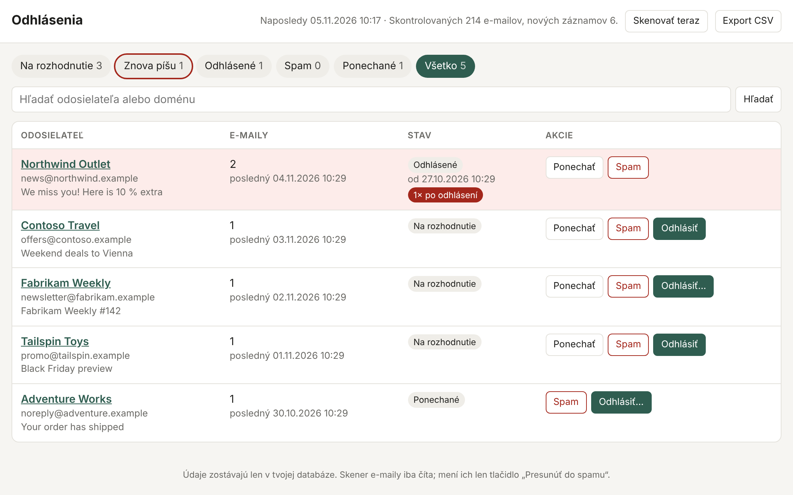

# inbox-unsub

*[Slovenská verzia](README.sk.md)*

**A small self-hosted app that keeps a record of which newsletters you unsubscribed from — and tells you when they start mailing you again anyway.**



*The UI is in Slovak. Sample data, fictional senders.*

---

## Why this exists

You click *unsubscribe*. The newsletters stop. A few weeks or months later they quietly come back.

This is a common experience, and in the EU it is usually not legal. Under the GDPR (Art. 21(3)), once you object to direct marketing, a company may no longer process your data for that purpose — permanently, not "for a while". The ePrivacy rules (in Germany § 7 UWG, in Slovakia the Electronic Communications Act) additionally require prior consent for marketing e-mail. Yet it keeps happening, typically because:

- you were removed from one list ("news") but not from another ("offers", "partners"),
- a later purchase or login silently re-subscribed you (pre-ticked checkbox),
- your address was shared or sold, or re-imported from an old database.

The real problem is that **nobody keeps track**. After a while you simply don't remember whether you already unsubscribed from a shop, when, or how — so you can't tell whether a mail is a broken promise or just something you never cancelled. And without dates you have nothing to point to if you want to complain.

Existing tools don't quite cover this:

| Option | What's missing |
|---|---|
| Gmail's *Manage subscriptions* | Unsubscribes nicely, but keeps no history and doesn't notice re-subscriptions. |
| Cloud unsubscribe services (Unroll.me, Clean Email, …) | Need full access to your mailbox on someone else's server; some have monetised mail data. |
| Per-site aliases (SimpleLogin, addy.io, own domain catch-all) | Great prevention, but only for new sign-ups, and self-hosting them means running a mail server. |
| [Inbox Zero](https://github.com/elie222/inbox-zero) | A full AI mail assistant — heavy to self-host (OAuth app, Postgres, Redis, LLM key) if all you want is this one feature. |

**inbox-unsub** does exactly one thing: it watches your existing mailbox over plain IMAP, remembers every unsubscribe decision with a timestamp, and flags senders that write again after you opted out. One container, one SQLite file, no domain, no mail server, no OAuth app, no AI.

## Features

- **Read-only scanning** of one or more IMAP folders. Only headers are fetched (`BODY.PEEK[HEADER.FIELDS …]`) — message bodies and attachments are never downloaded, and messages are not marked as read.
- **Bulk-mail detection** from headers (see [How detection works](#how-detection-works)).
- **Decide per sender** in a web page: *Keep*, *Spam*, or *Unsubscribe*.
- **One-click unsubscribe** ([RFC 8058](https://www.rfc-editor.org/rfc/rfc8058)) when the sender supports it; otherwise the page shows the unsubscribe link / `mailto:` address and lets you confirm with *"I unsubscribed"*, noting how (link, GDPR request, account settings, …).
- **"Writing again" tab** — senders who mailed you more than `GRACE_DAYS` after you unsubscribed, with the list of offending messages and a full history per sender.
- **CSV export** with dates of unsubscription and number of mails received afterwards — ready-made evidence for a GDPR objection or a complaint to a data-protection authority.
- **Optional "move to spam"** for senders you marked as spam (uses IMAP `MOVE`, nothing is deleted).
- Small footprint: Python + Flask + SQLite, multi-arch image (amd64 / arm64 — runs on a Raspberry Pi).

## Deployment

### 1. Get an IMAP password

**Gmail:** plain-password IMAP logins are disabled, but app passwords still work.

1. Turn on [2-Step Verification](https://myaccount.google.com/signinoptions/two-step-verification) for your Google account.
2. Go to <https://myaccount.google.com/apppasswords>, create a password named e.g. `inbox-unsub`.
3. Copy the 16 characters **without spaces** — that's your `IMAP_PASSWORD`.

You can revoke it at any time from the same page.

**Other providers** work the same way; set `IMAP_HOST` accordingly. A few common ones:

| Provider | `IMAP_HOST` | Note |
|---|---|---|
| Gmail | `imap.gmail.com` | app password |
| Seznam.cz | `imap.seznam.cz` | check that IMAP access is allowed in settings |
| mailbox.org | `imap.mailbox.org` | |
| iCloud | `imap.mail.me.com` | app-specific password |
| Yahoo | `imap.mail.yahoo.com` | app password |

(Outlook.com / Microsoft 365 have phased out password-based IMAP in favour of OAuth, which this app doesn't support yet.)

### 2. Run with Docker Compose (recommended)

```bash
mkdir inbox-unsub && cd inbox-unsub
curl -LO https://raw.githubusercontent.com/jose1711/inbox-unsub/main/docker-compose.yml
curl -L  https://raw.githubusercontent.com/jose1711/inbox-unsub/main/.env.example -o .env
nano .env            # set IMAP_USER, IMAP_PASSWORD, WEB_PASSWORD
docker compose up -d
docker compose logs -f   # watch the first scan
```

Open `http://<host>:8080` and log in with `WEB_USER` / `WEB_PASSWORD`.

The first scan starts a few seconds after start-up and looks back `INITIAL_DAYS` (default 30) days; afterwards it runs every `SCAN_INTERVAL_MIN` minutes, or on demand via *Skenovať teraz* (*Scan now*). All data is stored in `./data/inbox.db`.

### Build from source instead

```bash
git clone https://github.com/jose1711/inbox-unsub.git
cd inbox-unsub
cp .env.example .env && nano .env
# in docker-compose.yml: comment out "image:", uncomment "build: ."
docker compose up -d --build
```

### Without Docker

Requires Python 3.10+.

```bash
git clone https://github.com/jose1711/inbox-unsub.git && cd inbox-unsub
python3 -m venv .venv && . .venv/bin/activate
pip install -r requirements.txt
cp .env.example .env && nano .env
set -a && . ./.env && set +a
python app.py
```

To keep it running, wrap it in a systemd service (`EnvironmentFile=/path/to/.env`, `ExecStart=/path/to/.venv/bin/python app.py`).

### Behind a reverse proxy (HTTPS)

The app has HTTP basic auth but no TLS. Keep it on your LAN / VPN, or put it behind a reverse proxy. Example with Caddy:

```caddy
inbox.example.com {
    reverse_proxy inbox-unsub:8080
}
```

### Updating and backups

```bash
docker compose pull && docker compose up -d     # update
cp data/inbox.db inbox-$(date +%F).db           # backup (SQLite file, safe to copy)
```

### Useful commands

```bash
docker compose run --rm inbox-unsub python app.py --list-folders   # exact IMAP folder names
docker compose run --rm inbox-unsub python app.py --scan           # one scan, then exit
docker exec inbox-unsub python app.py --rescan                     # re-check the last INITIAL_DAYS days (e.g. after an update)
```

## Configuration

All settings are environment variables (see [`.env.example`](.env.example)):

| Variable | Default | Meaning |
|---|---|---|
| `IMAP_HOST` / `IMAP_PORT` | `imap.gmail.com` / `993` | IMAP server (implicit TLS) |
| `IMAP_USER` / `IMAP_PASSWORD` | – | login (app password for Gmail) |
| `IMAP_FOLDERS` | `INBOX` | comma-separated folders to scan |
| `JUNK_FOLDER` | *(empty)* | target folder for *move to spam*; empty disables it. Gmail: usually `[Gmail]/Spam`. Folder names with non-ASCII characters must be given in IMAP's encoded form, exactly as `--list-folders` prints them. |
| `SCAN_INTERVAL_MIN` | `60` | scan interval in minutes (min. 5) |
| `INITIAL_DAYS` | `30` | how far back the first scan looks |
| `GRACE_DAYS` | `3` | tolerance after unsubscribing before a sender counts as "writing again" |
| `MIN_SCORE` | `3` | detection threshold for unknown senders (see below) |
| `BODY_KEYWORDS` | `unsubscribe,abmelden,opt-out` | words searched in message bodies on the IMAP server; empty disables it |
| `TZ` | `Europe/Berlin` | time zone used to display dates |
| `WEB_USER` / `WEB_PASSWORD` | `admin` / – | basic-auth credentials for the web UI |
| `DB_PATH` | `data/inbox.db` | SQLite database path |
| `PORT` | `8080` | HTTP port |

## How detection works

Each message gets a score from its headers:

| Signal | Points |
|---|---|
| `List-Unsubscribe` header present | 3 |
| `Precedence: bulk` / `list` / `junk` | 2 |
| `List-Id` header present | 1 |
| sender local part like `newsletter@`, `noreply@`, `marketing@`, `promo@`, `offers@` … | 1 |
| header added by a bulk-mail platform (`Feedback-ID`, `X-CSA-Complaints`, `X-Campaign…`, Mailgun, SendGrid, SES, Mailchimp, Listrak …) | 2 |
| bounce / VERP `Return-Path` or `Errors-To` (e.g. `…@bounce.shop.com`) | 1 |
| body contains a word from `BODY_KEYWORDS` (searched **on the server**, body is not downloaded) | 2 |
| Gmail only: message is in the *Promotions* category | 3 |

Some senders don't send any list headers at all, which is why the last four signals exist.

An **unknown** sender is recorded once a message reaches `MIN_SCORE` (default 3, i.e. anything with an unsubscribe link). Once a sender is in the database, **every** further message from that address is recorded — even if, after you unsubscribed, they stop sending list headers.

Senders are tracked by exact address. A company that mails from several addresses appears as several rows; the search box matches by domain to group them.

**About real spam:** for scams and unknown senders, don't use unsubscribe links — clicking them only confirms your address is alive. Mark them as *Spam* instead; the page hides the unsubscribe action for those.

## Privacy and security

- Your mailbox data never leaves your machine. The only outgoing requests besides IMAP are the one-click unsubscribe POSTs you trigger yourself.
- Only headers are read; the scanner opens folders read-only. The single action that changes your mailbox is the optional *move to spam* button.
- Always set `WEB_PASSWORD` — whoever can open the page can unsubscribe and move mail on your behalf. Forms are CSRF-protected.
- The IMAP password is an app password you can revoke independently of your main password.

## Limitations

- IMAP with password / app password only — no OAuth yet (so no Microsoft 365 / Outlook.com).
- Detection is header-based heuristics; very sloppy senders without list headers won't be picked up until you've seen them once via another path.
- UI is Slovak only for now.
- Single-user by design.

## What to do when someone writes after you unsubscribed

1. Open the sender in the *Znova píšu* (*Writing again*) tab — you have the unsubscribe date and every mail received afterwards.
2. Send them an objection under GDPR Art. 21 (stop direct marketing), optionally with Art. 17 (erasure) and Art. 15 (where did you get my address, who did you share it with). They have one month to respond.
3. If that doesn't help, complain to your data-protection authority (in Germany the authority of your federal state, in Slovakia *Úrad na ochranu osobných údajov*, in Czechia *ÚOOÚ*). The CSV export is your evidence.

*This is not legal advice.*

## License

[MIT](LICENSE)
