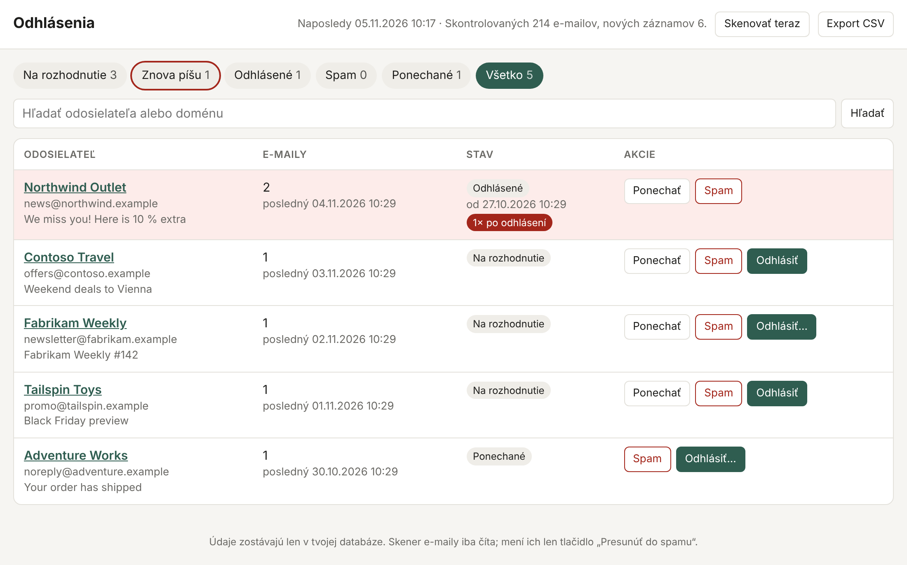

# inbox-unsub

*[English version](README.md)*

**Malá selfhostovaná aplikácia, ktorá si pamätá, z ktorých newsletterov si sa odhlásil, a upozorní ťa, keď ti aj tak začnú znova písať.**



## Prečo vznikla

Klikneš na *odhlásiť*, e-maily prestanú chodiť a po pár týždňoch či mesiacoch sa potichu vrátia.

V EÚ to väčšinou nie je legálne. Podľa GDPR (čl. 21 ods. 3) po námietke proti priamemu marketingu firma tvoje údaje na tento účel už nesmie spracúvať, a to natrvalo. Pravidlá o elektronických komunikáciách (v Nemecku § 7 UWG, na Slovensku zákon o elektronických komunikáciách) navyše vyžadujú na marketingové e-maily predchádzajúci súhlas. Napriek tomu sa to deje, typicky preto, že:

- si sa odhlásil len z jedného zoznamu („novinky“), ale nie z iného („akcie“, „partneri“),
- ťa pri ďalšom nákupe alebo prihlásení potichu znova prihlásili (predvyplnené políčko),
- tvoja adresa bola zdieľaná, predaná alebo znova naimportovaná zo starej databázy.

Skutočný problém je, že **nikto si to neeviduje**. Po čase si nepamätáš, či si sa od obchodu už odhlásil, kedy a ako. Nevieš teda, či ide o porušený sľub, alebo o niečo, čo si nikdy nezrušil. A bez dátumov nemáš na čo sa odvolať, ak sa chceš sťažovať.

Existujúce nástroje to úplne nepokrývajú: Gmail „Spravovať odbery“ si nevedie históriu, cloudové služby na odhlasovanie potrebujú plný prístup k schránke na cudzom serveri, aliasy (SimpleLogin, addy.io) pomôžu len pri nových registráciách a ich selfhosting znamená vlastný mail server. [Inbox Zero](https://github.com/elie222/inbox-zero) je zas celý AI asistent, ktorý je zbytočne ťažký, ak chceš len túto jednu funkciu.

**inbox-unsub** robí presne jednu vec: cez obyčajný IMAP sleduje tvoju existujúcu schránku, ku každému rozhodnutiu si uloží dátum a označí odosielateľov, ktorí píšu aj po odhlásení. Jeden kontajner, jeden SQLite súbor, bez vlastnej domény, mail servera, OAuth aplikácie aj AI.

## Funkcie

- **Iba čítanie hlavičiek** z jedného alebo viacerých IMAP priečinkov. Obsah e-mailov ani prílohy sa nesťahujú a správy sa neoznačia ako prečítané.
- **Rozpoznanie hromadnej pošty** podľa hlavičiek (pozri nižšie).
- **Rozhodnutie pri každom odosielateľovi:** *Ponechať*, *Spam* alebo *Odhlásiť*.
- **Odhlásenie jedným klikom** (RFC 8058), ak ho odosielateľ podporuje. Inak stránka ukáže odkaz alebo `mailto:` adresu a ty potvrdíš „Odhlásil som sa“ aj so spôsobom.
- **Záložka „Znova píšu“:** odosielatelia, ktorí písali viac ako `GRACE_DAYS` dní po odhlásení, so zoznamom týchto e-mailov a históriou.
- **Export CSV** s dátumami odhlásení a počtom e-mailov po nich, teda podklad pre GDPR námietku alebo sťažnosť.
- **Voliteľný presun do spamu** pre odosielateľov označených ako spam (IMAP `MOVE`, nič sa nemaže).
- Nenáročná: Python + Flask + SQLite, image pre amd64 aj arm64 (beží aj na Raspberry Pi).

## Nasadenie

### 1. Heslo pre IMAP

**Gmail:** prihlásenie obyčajným heslom nefunguje, heslá pre aplikácie áno.

1. Zapni [dvojstupňové overenie](https://myaccount.google.com/signinoptions/two-step-verification).
2. Na <https://myaccount.google.com/apppasswords> vytvor heslo (napr. `inbox-unsub`).
3. 16 znakov **bez medzier** vlož do `IMAP_PASSWORD`. Heslo môžeš kedykoľvek zrušiť na tej istej stránke.

Iní poskytovatelia (Seznam, mailbox.org, iCloud, Yahoo…) fungujú rovnako, len nastav `IMAP_HOST`. Outlook.com a Microsoft 365 vyžadujú OAuth, ktorý aplikácia zatiaľ nepodporuje.

### 2. Docker Compose (odporúčané)

```bash
mkdir inbox-unsub && cd inbox-unsub
curl -LO https://raw.githubusercontent.com/jose1711/inbox-unsub/main/docker-compose.yml
curl -L  https://raw.githubusercontent.com/jose1711/inbox-unsub/main/.env.example -o .env
nano .env                # vyplň IMAP_USER, IMAP_PASSWORD, WEB_PASSWORD
docker compose up -d
docker compose logs -f   # sleduj prvé skenovanie
```

Otvor `http://<server>:8080` a prihlás sa pomocou `WEB_USER` / `WEB_PASSWORD`. Prvé skenovanie začne pár sekúnd po štarte a prejde posledných `INITIAL_DAYS` dní. Ďalšie behy idú každých `SCAN_INTERVAL_MIN` minút, alebo ručne tlačidlom *Skenovať teraz*. Dáta sú v `./data/inbox.db`.

**Zostavenie zo zdrojákov:** naklonuj repozitár, v `docker-compose.yml` zakomentuj `image:` a odkomentuj `build: .`, potom spusti `docker compose up -d --build`.

**Bez Dockeru** (Python 3.10+):

```bash
git clone https://github.com/jose1711/inbox-unsub.git && cd inbox-unsub
python3 -m venv .venv && . .venv/bin/activate
pip install -r requirements.txt
cp .env.example .env && nano .env
set -a && . ./.env && set +a
python app.py
```

### HTTPS a prístup zvonku

Aplikácia má prihlásenie heslom, ale nemá TLS. Nechaj ju v domácej sieti alebo na VPN, prípadne ju daj za reverse proxy (Caddy, Traefik, nginx).

### Aktualizácia a záloha

```bash
docker compose pull && docker compose up -d     # aktualizácia
cp data/inbox.db inbox-$(date +%F).db           # záloha
```

### Užitočné príkazy

```bash
docker compose run --rm inbox-unsub python app.py --list-folders   # presné názvy priečinkov
docker compose run --rm inbox-unsub python app.py --scan           # jedno skenovanie a koniec
docker exec inbox-unsub python app.py --rescan                     # znova prejde posledných INITIAL_DAYS dní
```

## Nastavenia

Všetky nastavenia sú premenné prostredia v `.env`. Ich zoznam s popisom je v [`.env.example`](.env.example) a v [anglickom README](README.md#configuration).

## Ako sa rozpozná hromadný e-mail

| Znak | Body |
|---|---|
| hlavička `List-Unsubscribe` | 3 |
| `Precedence: bulk/list/junk` | 2 |
| hlavička `List-Id` | 1 |
| adresa typu newsletter@, noreply@, marketing@, promo@… | 1 |
| hlavička rozosielacej platformy (`Feedback-ID`, `X-CSA-Complaints`, `X-Campaign…`, Mailgun, SendGrid, SES, Mailchimp, Listrak…) | 2 |
| bounce/VERP adresa v `Return-Path` alebo `Errors-To` | 1 |
| v tele je slovo z `BODY_KEYWORDS` (hľadá **server**, obsah sa nesťahuje) | 2 |
| len Gmail: e-mail je v kategórii *Promo akcie* | 3 |

Neznámy odosielateľ sa zapíše od skóre `MIN_SCORE` (predvolene 3). Odosielateľ, ktorý už v databáze je, sa sleduje vždy, aj keby po odhlásení prestal posielať tieto hlavičky. Sleduje sa presná adresa a vyhľadávanie podľa domény zoskupí viac adries jednej firmy.

Od skutočného spamu (podvody, neznámi odosielatelia) sa **neodhlasuj**, lebo tým len potvrdíš, že adresa je aktívna. Označ ho ako *Spam*.

## Keď ti niekto píše po odhlásení

1. V záložke *Znova píšu* máš dátum odhlásenia a všetky e-maily, ktoré prišli potom.
2. Pošli im námietku podľa čl. 21 GDPR, prípadne žiadosť o výmaz (čl. 17) a o informáciu, odkiaľ adresu majú (čl. 15). Na odpoveď majú mesiac.
3. Ak to nepomôže, podaj sťažnosť dozornému orgánu (na Slovensku Úrad na ochranu osobných údajov, v Česku ÚOOÚ, v Nemecku úrad tvojej spolkovej krajiny). Export CSV je tvoj dôkaz.

*Nejde o právne poradenstvo.*

## Licencia

[MIT](LICENSE)
